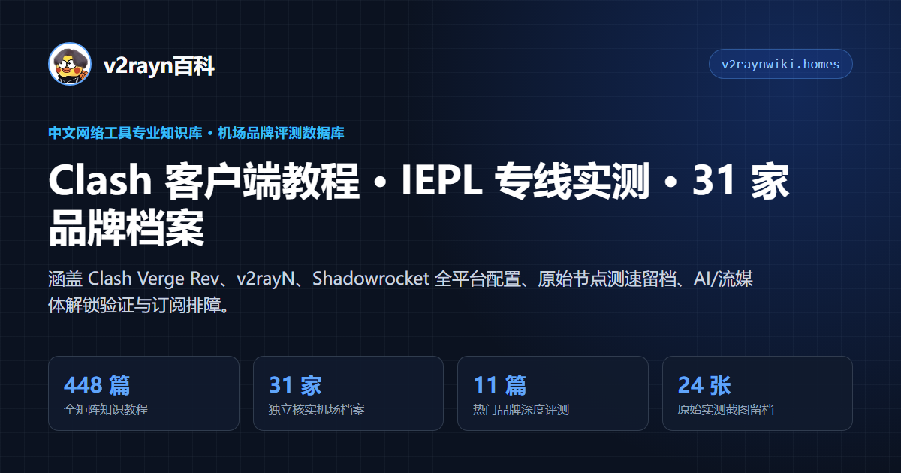

<div align="center">
  
  <h1>v2rayn百科 · <code>v2raynwiki.homes</code></h1>
  <p><strong>面向中文用户的网络代理技术文档库与机场品牌评测数据库</strong></p>
  <p>基于 VitePress 1.6 + Vue 3 + TypeScript 构建，覆盖客户端工程手册、31 家品牌实况审计、Dark Network Observatory 实测图表、GEO/AEO 结构化端点与全站 SEO 自动化验收流水线。</p>

  <p>
    
    
    
    
    
    
  </p>

  <p>
    <a href="https://v2raynwiki.homes/">在线主站</a> ·
    <a href="https://v2raynwiki.homes/brands/">品牌数据库</a> ·
    <a href="https://v2raynwiki.homes/reviews/guangsuyun">光速云旗舰评测</a> ·
    <a href="https://v2raynwiki.homes/llms.txt">llms.txt (GEO)</a> ·
    <a href="https://v2raynwiki.homes/sitemap.xml">Sitemap</a>
  </p>

  
</div>

---

## ✨ 核心特性与架构亮点

| 维度 | 核心实现 |
| :--- | :--- |
| **全量知识库矩阵** | **4 个一级支柱**（机场推荐 / VPN 与加速器 / Clash 客户端 / 资源与情报）→ **28 个二级专题** → **56 个三级集群 × `448` 篇长尾教程**（`56 P0 + 224 P1 + 168 P2`，均值 `3,210` 汉字，含 `<details>` 语义 FAQ） |
| **31 家品牌与评测库** | **31 家独立核实品牌档案**（已完成 `Firefly` 去重合并与字段冲突披露）+ **11 家热门品牌深度评测**（光速云万字旗舰评测 + 前十品牌）+ **6 篇横向对比专题** |
| **Dark Observatory 观测系统** | 自研暗夜观测仪表盘与交互筛选组件：`<BrandDatabaseExplorer />`、`<AirportMatcher />` 30 秒选型器、`<NetworkPerformanceReport />`、`<StreamingAvailabilityMatrix />`、`<NetworkTopology />`、`<BrandScreenshots />` |
| **原始实测截图与 WebP 加速** | `docs/public/images/` 完整保留 `2026-08-19`（2Gbps 三网 + 9Gbps 单线程）与 `2026-08-11 MAI-TEST-BOT` 原始 PNG/JPG，自动加载 `WebP` 轻量预览并附原生 `width`/`height` 防 CLS |
| **GEO / AEO 与结构化 Schema** | 原生生成 `/llms.txt` 与 `/brands.json`；全站 `541` 个可索引页自动注入 JSON-LD（`Organization`、`WebSite`、`CollectionPage`、`Article`、`WebPage`、`SoftwareApplication`、`ItemList`、`BreadcrumbList`、`FAQPage`） |
| **搜索引擎与风控合规** | 原生 `sitemap.xml`（`541` 条 URL）、`robots.txt`、`index, follow` 控制、Google / Bing / 神马 / 百度四端验证钩子、`1,521` 条合作跳转严格携带 `rel="nofollow sponsored noopener"` |
| **检索与 Apache 一键部署** | 内置 VitePress 本地中文检索并无缝支持 Algolia（`npm run algolia:sync` 抽出 `4,330` 条预览索引）；自带 `.htaccess` 强制 HTTPS/去 `www`/尾斜杠 301 与真 `404` 打包脚本 |

---

## 🚀 快速开始与工程命令

环境要求：**Node.js >= 20**（已验证于 `Node v24.19.0` + `npm`）

```bash
# 1. 安装依赖
npm install

# 2. 启动本地开发热更新服务
npm run dev

# 3. 生产环境完整构建与合规体检（GEO feeds → VitePress build → verify-site.mjs）
npm run build:check

# 4. 本地预览生产静态产物（默认端口 4173）
npm run preview

# 5. 生成含 .htaccess 的 Apache 一键部署包（输出至 deploy/v2raynwiki-homes-apache-dist.zip）
npm run deploy:pack

# 6. 上线部署后执行线上 HTTP 状态 / 301 规范化 / 404 回测
npm run deploy:check -- https://v2raynwiki.homes

# 7. 提取或推送 Algolia 搜索索引（需在 .env 配置公开 Key，Admin Key 走命令行）
npm run algolia:sync

# 8. 主动推送规范 URL 至 IndexNow（Bing / ChatGPT Search）
npm run indexnow:push -- --submit
```

---

## 📁 目录结构

```text
v2raynwiki.homes/
├── docs/
│   ├── airport/                  # 一级导航：机场推荐（7 个二级专题 / 14 集群 / 112 篇）
│   ├── vpn/                      # 一级导航：VPN 与加速器（7 个二级专题 / 14 集群 / 112 篇）
│   ├── clash/                    # 一级导航：Clash 客户端（7 个二级专题 / 14 集群 / 112 篇）
│   ├── resources/                # 一级导航：资源与情报（7 个二级专题 / 14 集群 / 112 篇）
│   ├── brands/                   # 31 家品牌交互数据库首页 & 独立品牌档案页
│   ├── reviews/                  # 光速云万字旗舰评测 & 前十品牌深度评测中心
│   ├── comparisons/              # 高意图横向对比专题（三强 / 5.6元审计 / IEPL / AI / 客户端模式）
│   ├── clients/                  # Windows / Android / iOS / macOS / Linux / OpenWrt 指南
│   ├── about/                    # 关于本站、评测方法论、推广披露、隐私边界与运维手册
│   ├── public/                   # .htaccess、robots.txt、avatar.jpg、og-cover.png、原图与 WebP 预览
│   └── .vitepress/
│       ├── config.mts            # 主配置（Canonical / Meta / Sitemap / JSON-LD / 搜索）
│       ├── data/                 # 唯一数据源真源（site.ts / links.ts / brands.ts / clients.ts / navigation.ts）
│       └── theme/components/     # 首页知识库、选型配对器、观测图表与合规转化组件
├── scripts/
│   ├── generate-knowledge-base.mjs  # 448 篇集群与 content-planning/ 规划文档生成器
│   ├── article-enrichment.mjs       # 按角度差异化的技术原理、实测矩阵与排障生成器
│   ├── topic-deep-modules.mjs       # 28 个二级专题深层配置与工程代码库
│   ├── generate-geo-feeds.mjs       # 生成 llms.txt 与 brands.json 结构化端点
│   ├── verify-site.mjs              # 全站死链、Meta、外链属性与合规自动化门禁
│   ├── sync-algolia.mjs             # Algolia 记录提取与索引推送
│   ├── push-indexnow.mjs            # IndexNow URL 主动提交
│   ├── package-apache.mjs           # 构建产物流水线打包含 .htaccess 归档
│   └── check-live-apache.mjs        # 生产环境 301 / 200 / 404 远程验证脚本
├── content-planning/             # 13 份完整 SEO/GEO 规划、标题库、关键词表与品牌审计交付文档
├── algolia/                      # DocSearch 抓取规则与索引抽样预览
├── .env.example                  # Algolia 与 Google/Bing/神马/百度站长验证环境变量模板
├── PROGRESS.md                   # 项目阶段验收指标与构建记录
└── package.json
```

---

## 🔧 搜索与站长平台环境变量接入

复制 [.env.example](.env.example) 为 `.env`（已被 `.gitignore` 忽略，**严禁提交包含私有密钥的 `.env` 至仓库**）：

```ini
# Algolia 全文搜索（仅填写公开 Search-Only Key；不填则自动使用内置本地中文搜索）
VITE_ALGOLIA_APP_ID=
VITE_ALGOLIA_API_KEY=
VITE_ALGOLIA_INDEX_NAME=v2raynwiki_homes

# 四大搜索引擎站长平台验证（构建时静态写入 HTML <head>，无需修改组件代码）
VITE_GOOGLE_SITE_VERIFICATION=
VITE_BING_SITE_VERIFICATION=
VITE_SHENMA_SITE_VERIFICATION=
VITE_BAIDU_SITE_VERIFICATION=
```

配置完成后执行：

```bash
npm run build:check
npm run deploy:pack
```

---

## 🛠 日常维护与单一数据源规范

1. **所有推广链接集中在 [`docs/.vitepress/data/links.ts`](docs/.vitepress/data/links.ts)**：严禁在 Markdown 中硬编码外链推广 URL，确保 `rel="nofollow sponsored noopener"` 全站 100% 统一。
2. **所有品牌参数集中在 [`docs/.vitepress/data/brands.ts`](docs/.vitepress/data/brands.ts)**：更新套餐、测速或解锁状态后，可通过 `node scripts/generate-knowledge-base.mjs` 与 `npm run build:check` 同步刷新品牌档案、对比矩阵与 `/brands.json`、`/llms.txt`。
3. **目录导航唯一真源 [`docs/.vitepress/data/navigation.ts`](docs/.vitepress/data/navigation.ts)**：统一驱动顶部导航、侧边栏层级与全站面包屑。

---

## 📄 商业披露与数据真实性原则

- **客观审计边界**：本站区分原始实测留档（`measured`）、品牌资料整理（`vendor`）与历史归档（`historical`），保留优惠码版本冲突、路由缺失提示及异常低速节点快照，不编造虚假五星评分。
- **推广关系透明**：商业合作优先级不影响技术教程客观性与原始测速截图展示，所有合作跳转入口均在组件与文档中明示推广披露。
